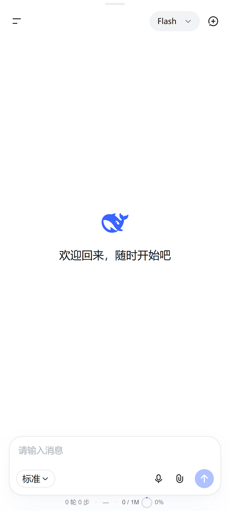
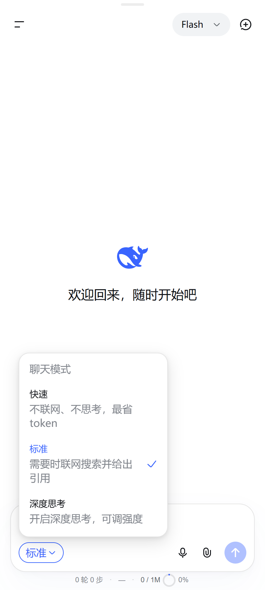
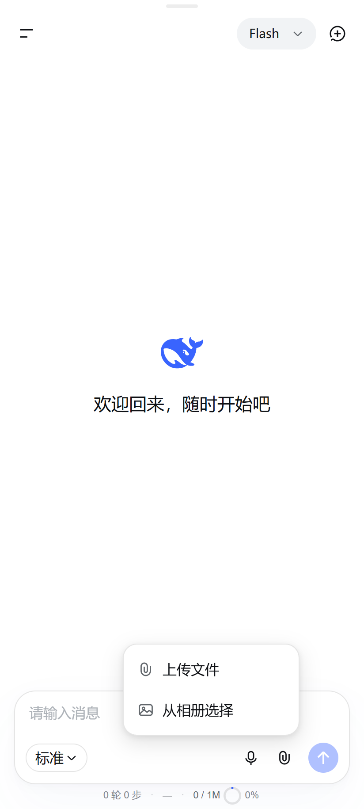
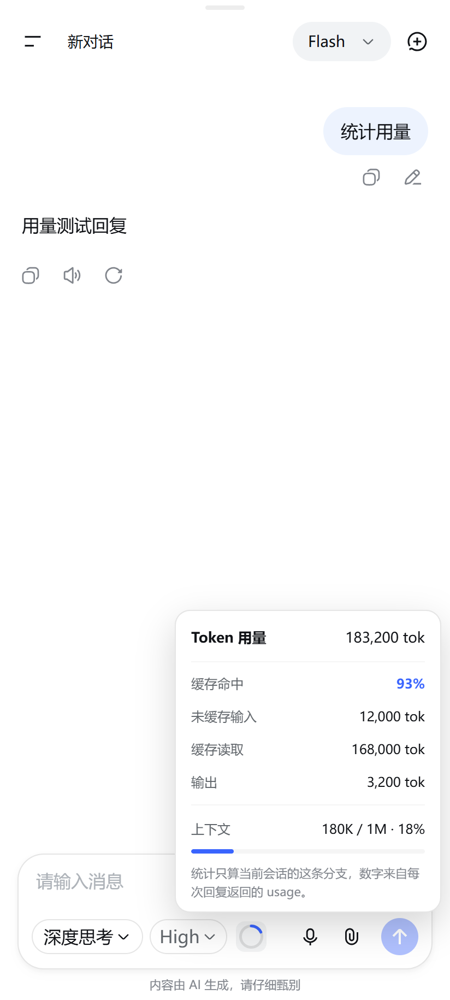
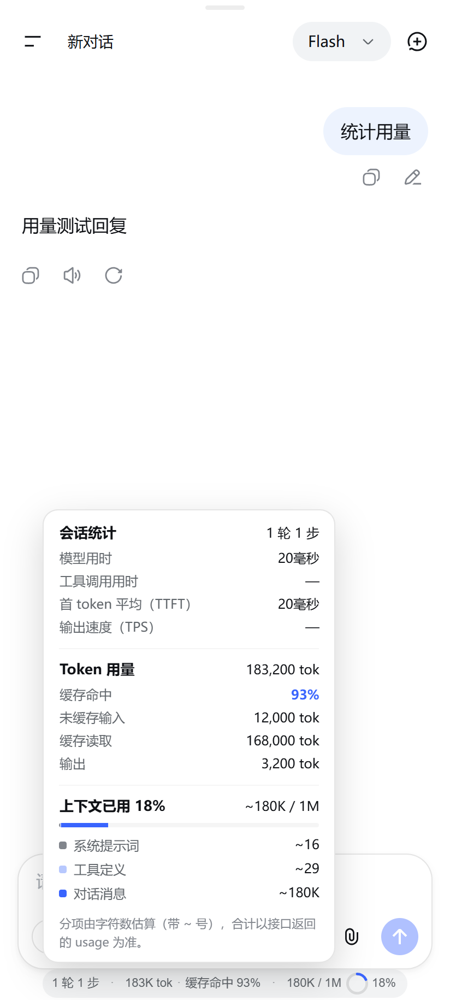
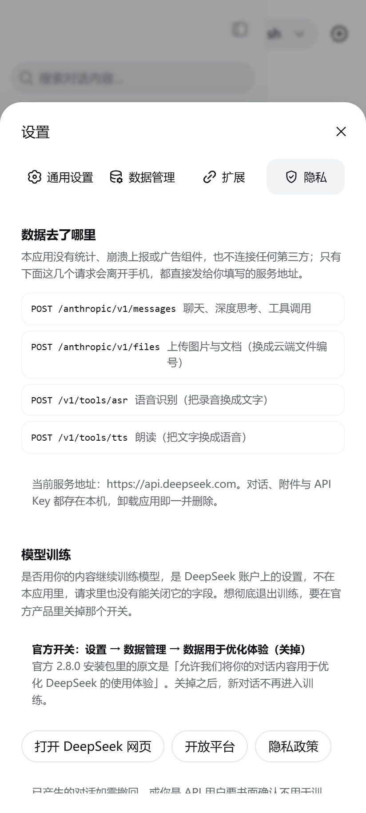
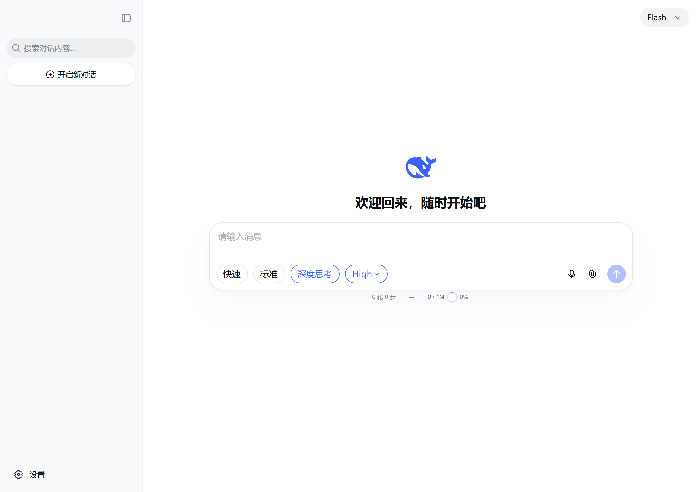
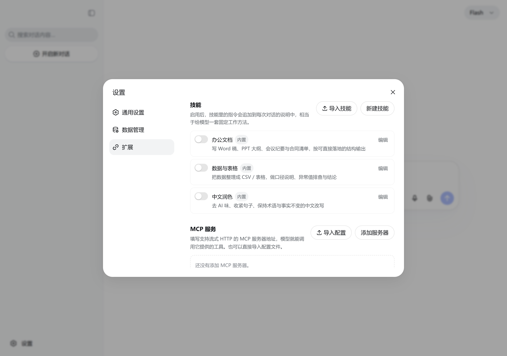

<p align="center">
  
</p>

<h1 align="center">DS Chat</h1>

<p align="center">
  <b>A 2 MB third-party chat client</b><br>
  Paste your own API key, talk straight to DeepSeek's open API — and see exactly where your tokens went
</p>

<p align="center">
  <b>English</b> · <a href="README.md">简体中文</a>
</p>

<p align="center">
  
  
  
  
  
</p>

## First things first: this is not an official app

DS Chat is a **third-party client written by one person**. It is not affiliated with, endorsed by, or connected to Hangzhou DeepSeek Artificial Intelligence Co., Ltd. It is not an official product; it does not redistribute or repackage any official binary, and its interface is not a copy of the official app.

- **Where the code comes from.** `web/` is a rewrite on top of DeepSeek's **open-source** [chat-demo](https://github.com/deepseek-ai/chat-demo) (MIT). The Android side is a WebView shell written from scratch. Every line is in this repository.
- **How the marks are used.** "DS" and the whale are used only to say *which service this app talks to* — nominative use. "DeepSeek", "深度求索" and the whale mark belong to DeepSeek; this project claims no rights over them.
- **What you may do with it.** MIT: fork it, rename it, change the icon, ship it commercially. If you redistribute it, change the name and the icon so nobody mistakes it for the official product.
- **Who to ask for support.** This repository — not DeepSeek support. They have nothing to do with this project.

## What it is

DS Chat is a third-party client that turns DeepSeek's open API into a phone app: no self-hosted backend, no server config, just an API key. It also puts the numbers API users actually watch — cache hit rate, time to first token, output speed, context occupancy — into the interface instead of leaving them in a log file.

## What it is and is not

- **Not an official product, and not a patched official app.** No official binary was ever decompiled, injected or re-signed; the UI was redesigned on top of the MIT-licensed demo, and all of that source is here.
- **No backend.** The web build is a static bundle and the Android app is a thin WebView shell. Every request goes straight from your phone to the server address you configure; there is no server of mine in between.
- **Usage on the surface.** Three places show the real numbers: a token popover, a status line under the composer, and a session stats panel — cache hit rate, uncached input / cache read / output, TTFT, TPS, how much of the 1M context is used, and the split between system prompt, tool definitions and messages.
- **Modes are cost switches.** Fast mode never searches and never thinks (cheapest), Standard searches on demand and shows citations, Deep thinking has its own effort level: Off / Low / High / Max.
- **Data stays on the device.** Conversations, drafts, original attachments, skills, MCP config and the API key live in IndexedDB + localStorage. There is no account system; uninstalling deletes everything.

## At a glance

| | |
| --- | --- |
| Version | 0.3.9 (versionCode 14) |
| Package | 2.0 MB, Android 7.0+ (minSdk 24 / targetSdk 35) |
| Models | Flash / V4 Pro, both with a 1M-token context |
| Protocol | Anthropic-compatible Messages: `POST {server}/anthropic/v1/messages` |
| Frontend | React 18 + TypeScript + rspack, 4.3 MB static output |
| Permissions | `INTERNET` and `RECORD_AUDIO` only |
| License | MIT |

## Screenshots

| Chat | Modes & effort | Attachments |
| :--: | :--: | :--: |
|  |  |  |
| Status line under the composer: rounds/steps, tokens, context ring | Modes laid out flat; the effort capsule appears only in deep thinking | The paperclip asks first: upload a file, or pick from the gallery |

| Token usage | Session stats | Privacy |
| :--: | :--: | :--: |
|  |  |  |
| Cache hit rate, uncached input / cache read / output, context usage | Rounds/steps, model time, TTFT, TPS, context breakdown | Which requests leave the phone, where the training toggle lives, local storage |

| Desktop | Extensions: skills and MCP |
| :--: | :--: |
|  |  |
| Wide screens get a sidebar + conversation layout | Import skills as `.md` / JSON; add a streamable HTTP MCP server and test it |

> Screenshots are real renders at 824×1830 (mobile) and 2560×1800 (desktop) — no mockups.

## Features

### Chat

- Two models: **Flash** (everyday, fast) and **V4 Pro** (hard reasoning, slower), both 1M context
- Three chat modes plus four effort levels — `thinking: {type: enabled}` with `output_config.effort`, matching the official client (Off / Low / High / Max)
- Streaming, collapsible reasoning ("thought for N seconds"), message versions (switch between regenerations), edit-and-resend, continue generating
- Web search with citations: how many pages were searched and which were read; inline citations expand into source cards
- Markdown, syntax highlighting, KaTeX, Mermaid diagrams (toggle back to source)

### Input

- Files and images: PDF, DOC, XLSX, PPT, images, text, code. Multi-select from the gallery (Photo Picker on Android 13+, no storage permission). Tapping an attachment previews it instead of deleting it
- Voice input: native `AudioRecord` in the app (16 kHz mono 16-bit PCM → WAV → `POST /v1/tools/asr`), up to 120 s per take, with an optional model pass that strips filler words, adds punctuation and fixes homophones
- Read aloud: `POST /v1/tools/tts`, two voices

### Extensions

- **Skills**: three built in (office docs, data & tables, Chinese polish); import `.md` (SKILL.md front matter) or JSON, or write your own. Only enabled skills are injected, capped at 8,000 chars each and 24,000 total
- **MCP**: add a streamable-HTTP server and the model can call its tools; config import and connection test included. Up to 64 tools, each result truncated at 8,000 chars

### Usage and data

- Token popover: cache hit rate, uncached input, cache read, output, context bar
- Session stats: rounds/steps, model time, tool time, TTFT, TPS, context split into system prompt / tool definitions / messages
- Import and export of chat history (compatible with the ZIP DeepSeek exports)
- Privacy panel: the four outbound requests, where the training toggle lives, local storage usage, clear saved location, delete all conversations and attachments

### Appearance

- Light / dark / follow system; Simplified Chinese and English
- Separate mobile and desktop layouts; the four settings tabs share the width evenly on narrow screens

## Install

Download `ds-chat-0.3.9.apk` (2.0 MB) from [Releases](https://github.com/__OWNER__/__REPO__/releases).

```
file      ds-chat-0.3.9.apk
size      2,047,331 bytes
SHA-256   6C3DE4130255705468A02C113F634A86ECA4D34637CC510F8C4F48122F240251
```

- Android 7.0 (API 24) and up; targetSdk 35
- **Signed with a debug certificate** (`CN=Android Debug`). This is not a store app: Android will warn about unknown sources and you have to allow it. Later versions use the same keystore, so updates install over the top
- No Play Store build, and there won't be one

No APK needed either: `web/` builds into a plain static site you can host anywhere — even open it over `file://` (`publicPath: auto` exists for exactly that).

## Quick start

1. Create an API key at [platform.deepseek.com](https://platform.deepseek.com)
2. Open the app and paste it in (Settings → Data → API key)
3. To use a relay or your own backend, fill in the server address. **Note:** it must serve `/anthropic/v1/*` and `/v1/tools/*`; an OpenAI-only relay needs an adapter
4. Pick a model and a mode

## Build from source

Web:

```bash
cd web
pnpm install
pnpm build        # output in web/dist
pnpm dev          # dev server at http://localhost:8090
```

Android:

```bash
cd android
./build-apk.sh    # needs Android SDK build-tools 35.0.0 and a JDK; see docs/BUILD.md
```

Prerequisites, signing and verification steps are in [docs/BUILD.md](docs/BUILD.md).

## Layout

```
web/                  frontend (React 18 + TypeScript + rspack)
  src/app             app shell, layout, route state
  src/components/     base / chatInput / files / markdown /
                      messages / search / session / settings / sider
  src/services/       API client, conversations and history, markdown, speech, native bridge
  src/i18n/           zh / en strings
android/              Android shell (WebView + native bridge, no Gradle)
docs/                 build, architecture and privacy notes
screenshots/          images used in this README
```

More in [docs/ARCHITECTURE.md](docs/ARCHITECTURE.md).

## Data and privacy

Only four request kinds leave the app, and all of them go to the server address you configure:

| Request | Purpose |
| --- | --- |
| `POST /anthropic/v1/messages` | chat, reasoning, tool calls |
| `POST /anthropic/v1/files` | upload images and documents, get a file id back |
| `POST /v1/tools/asr` | speech to text |
| `POST /v1/tools/tts` | text to speech |

There is no analytics SDK, no crash reporting, no ads, and no third-party domain in the code — grep the `https://` occurrences in `src/` yourself. Conversations and attachments are stored in IndexedDB, the API key in localStorage.

Two things this app cannot control:

- **Whether your content trains the model is a DeepSeek account setting**, not a client one, and there is no request field for it. To opt out, turn it off in the official product: Settings → Data → "Data used to improve the experience".
- **Once you point the server address at a third-party relay, that party sees your data.** Direct to the official endpoint, requests only pass between you and DeepSeek.

See [docs/PRIVACY.md](docs/PRIVACY.md) and the [DeepSeek privacy policy](https://cdn.deepseek.com/policies/zh-CN/deepseek-privacy-policy.html).

## Known limitations

- Debug signing: not distributable through app stores, and every install needs the unknown-sources prompt
- Voice input needs the server's `/v1/tools/asr`; in a browser, microphone access requires HTTPS
- MCP supports streamable HTTP only, not stdio
- The server address must expose Anthropic-compatible `/anthropic/v1/*`; OpenAI-only relays need an adapter
- No account sync or multi-device roaming — moving phones means export + import
- Personal project: the APK build is not covered by CI (only type check / lint / build for the web app run in GitHub Actions)

## Changelog

See [CHANGELOG.md](CHANGELOG.md). Last three releases:

- **0.3.9** new Privacy section in settings: where data goes, where the training toggle lives, local usage and one-tap clearing
- **0.3.8** voice clean-up: the transcript goes through the model once — filler words out, punctuation in, homophones fixed
- **0.3.7** the paperclip asks "file or gallery" first, multi-select in the gallery, tapping an attachment previews it

## Credits

- The frontend is based on DeepSeek's open-source [chat-demo](https://github.com/deepseek-ai/chat-demo) (MIT); much of the UI and interaction originates there
- The whale icon and the "DeepSeek" name belong to DeepSeek
- Hero image generated with MiniMax-H3-Image

## License

[MIT](LICENSE): keep the copyright notice and you can use, modify and redistribute it freely, commercially too. Upstream MIT notice in [NOTICE.md](NOTICE.md).

Provided "as is", without warranty of any kind. It is not associated with DeepSeek, and you pay for your own API usage.
