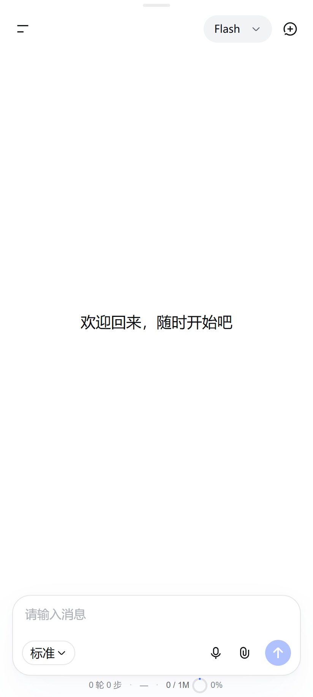
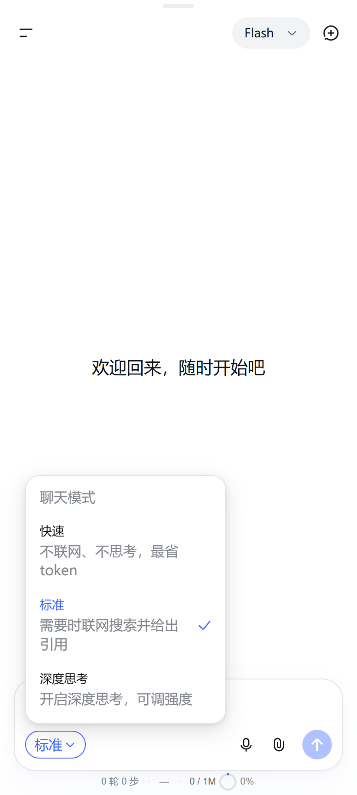
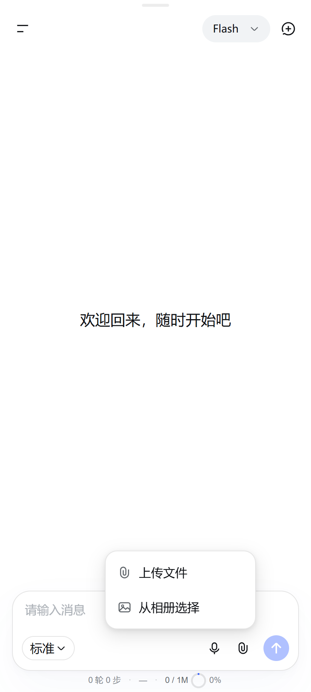
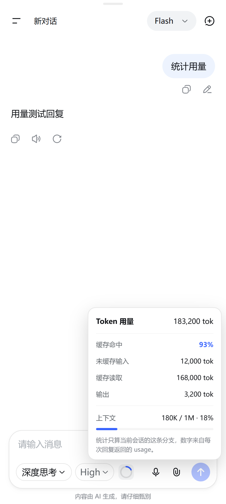
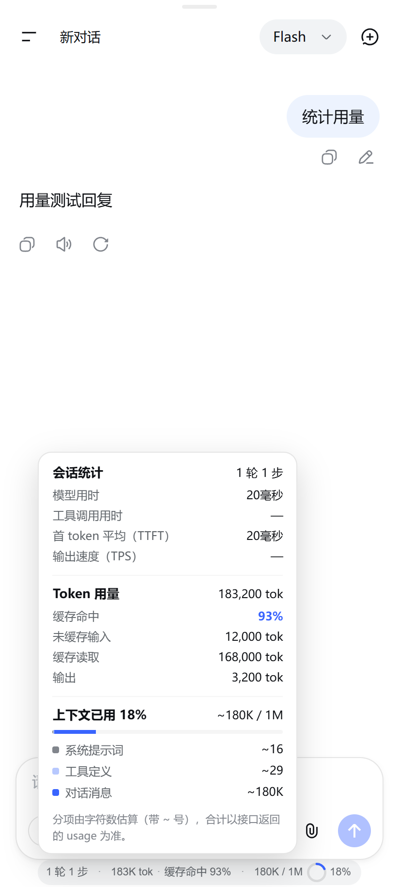
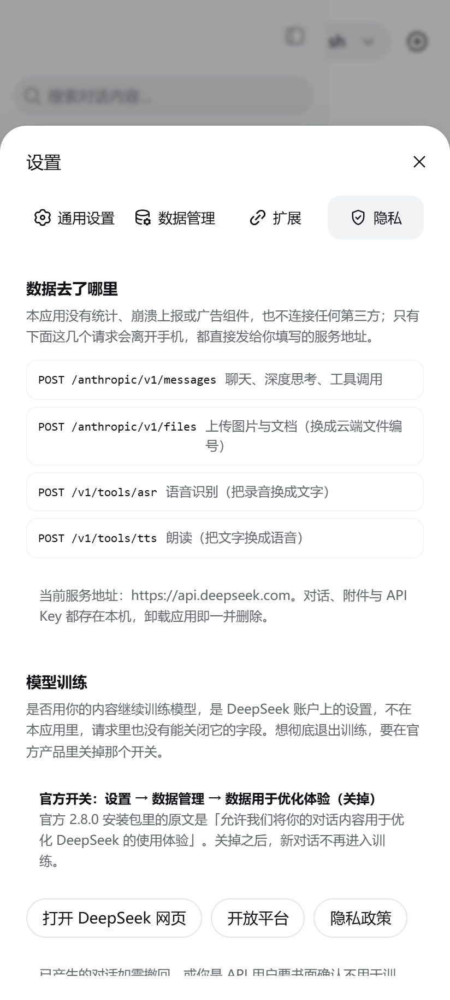
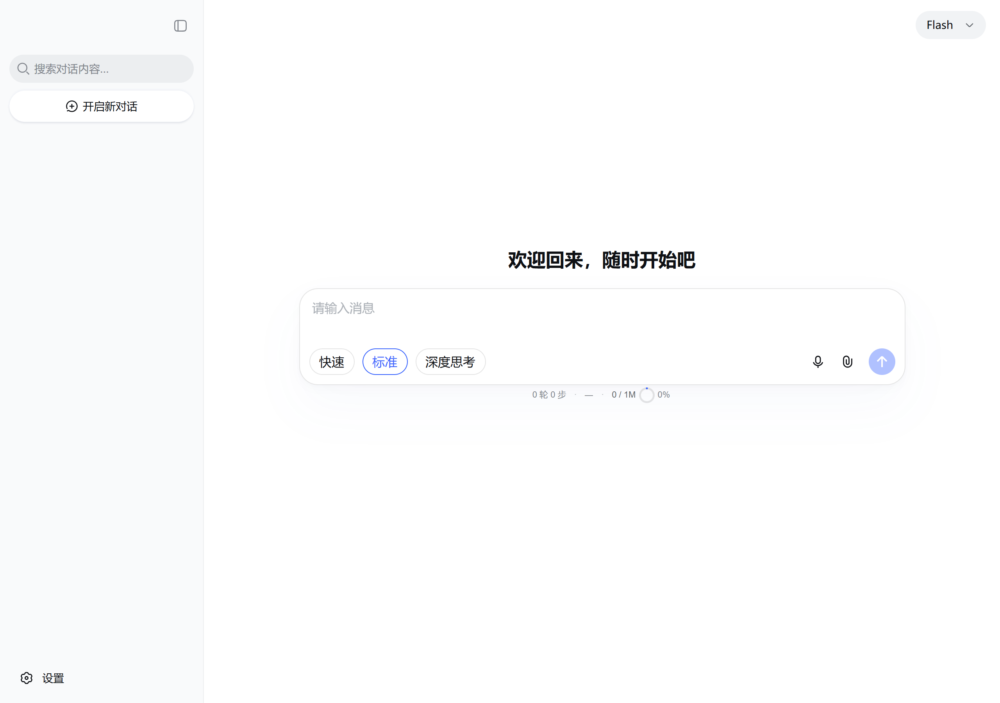
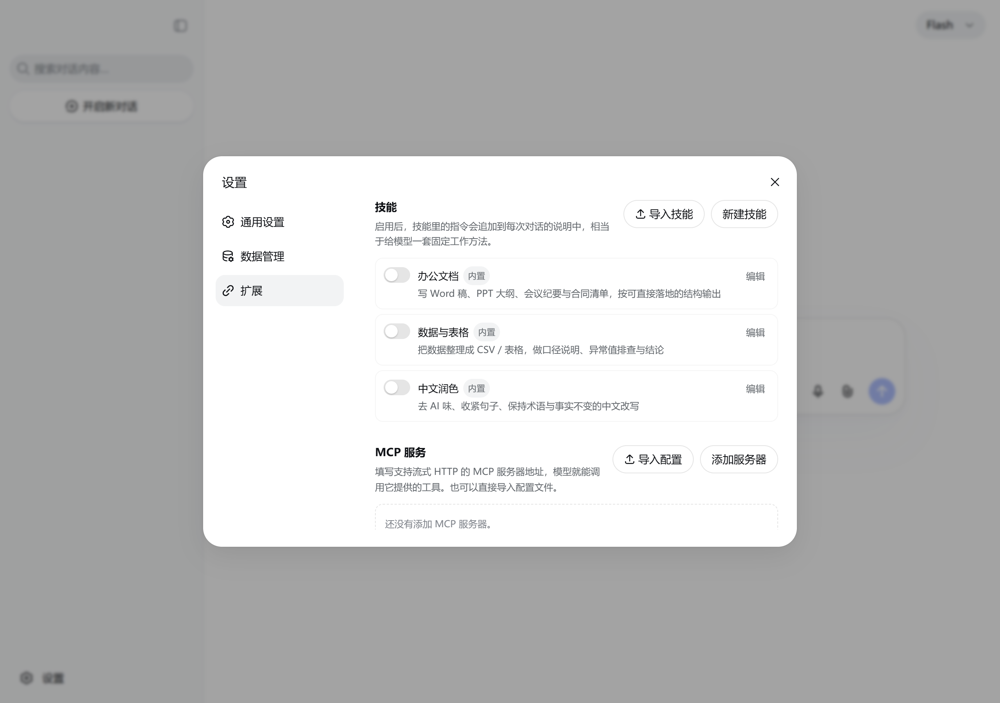

<p align="center">
  
</p>

<h1 align="center">DS Chat</h1>

<p align="center">
  <b>一个 2 MB 的第三方聊天客户端</b><br>
  自己填 API Key，直连 DeepSeek 的开放接口——顺便看清楚 token 花在了哪里
</p>

<p align="center">
  <a href="README.en.md">English</a> · <b>简体中文</b>
</p>

<p align="center">
  
  
  
  
  
</p>

## 先说清楚：这不是官方 App

DS Chat 是一个**个人开发的第三方客户端**。它与杭州深度求索人工智能基础技术研究有限公司（DeepSeek）没有隶属、合作或背书关系，不是官方产品；不分发、不再打包任何官方安装包，界面也不是官方 App 的复刻。

- **代码从哪来**：`web/` 是在 DeepSeek **开源**的 [chat-demo](https://github.com/deepseek-ai/chat-demo)（MIT）上重写的，Android 端是自己写的 WebView 壳。全部源码都在这个仓库里，可以逐行对照。
- **商标怎么用**：名称里的 "DS" 只用来表明"这个软件连的是 DeepSeek 的接口"，属于描述性使用；"DeepSeek"、"深度求索" 及其鲸鱼标识归深度求索所有，本项目不主张任何权利。界面与图标里**没有**使用官方标识——0.3.10 起连首页的鲸鱼也删掉了，图标换成了一个中性的对话气泡。
- **你可以怎么用**：MIT 许可，可以 fork、改名、换图标、商用。如果重新发布，请换掉名称与图标，别让人误以为是官方产品。
- **出问题找谁**：找这个仓库，不要找官方客服——官方没有参与这个项目。

## 一句话

DS Chat 是一个自己动手写的第三方客户端：不用自建后端、不用配服务器，填一个 API Key 就能聊；同时把用 API 的人真正会盯着的那些数字——缓存命中率、首 token 延迟、输出速度、上下文占用——做进了界面，而不是藏在日志里。

## 它是什么，不是什么

- **不是官方产品，也不是官方 App 的修改版。** 官方安装包从未被反编译、注入或重新签名；界面是在 MIT 许可的开源 demo 上重新设计的，每一行源码都在这个仓库里。
- **没有后端。** 网页端是一份纯静态资源，Android 端是一个 WebView 壳；每个请求都从你的手机直接发到你填的服务地址，中间没有我的服务器。
- **用量摊开给你看。** Token 用量弹层、输入框下方的状态条、会话统计面板，三处都有数：缓存命中率，未缓存输入 / 缓存读取 / 输出，TTFT，TPS，上下文占掉 1M 的百分之几，以及系统提示词、工具定义、对话消息各占多少。
- **模式就是省钱的开关。** 快速模式不联网不思考（最省 token），标准模式按需搜索并给出引用，深度思考可以单独调强度 Off / Low / High / Max。
- **数据留在手机上。** 对话、草稿、附件原件、技能与 MCP 配置、API Key 都在本机（IndexedDB + localStorage），没有账号体系，卸载即删。

## 一眼看全

| 项目 | 值 |
| --- | --- |
| 版本 | 0.3.10（versionCode 15） |
| 安装包 | 2.0 MB，Android 7.0+（minSdk 24 / targetSdk 35） |
| 模型 | Flash / V4 Pro，均为 1M 上下文 |
| 协议 | Anthropic 兼容 Messages：`POST {服务地址}/anthropic/v1/messages` |
| 前端 | React 18 + TypeScript + rspack，纯静态产物 4.3 MB |
| 权限 | 只有 `INTERNET` 与 `RECORD_AUDIO` |
| 许可 | MIT |

## 截图

| 对话 | 模式与思考强度 | 附件 |
| :--: | :--: | :--: |
|  |  |  |
| 首页：底部一行状态条（轮/步、token 总量、上下文环） | 三种模式平铺，选了深度思考才出现强度胶囊 | 点回形针先问一句：上传文件，还是从相册选 |

| Token 用量 | 会话统计 | 隐私 |
| :--: | :--: | :--: |
|  |  |  |
| 缓存命中率、未缓存输入 / 缓存读取 / 输出、上下文占用 | 轮/步、模型用时、TTFT、TPS、上下文三段分布 | 哪些请求会离开手机、训练开关在哪、本机占用 |

| 桌面端 | 扩展：技能与 MCP | 图标 |
| :--: | :--: | :--: |
|  |  |  |
| 宽屏是「边栏 + 对话」两栏，模式平铺在输入框里 | 技能可以导入 `.md` / JSON，MCP 填流式 HTTP 地址，可测连接 | 中性的对话气泡，不带任何官方标识 |

> 截图来自移动端 824×1830、桌面端 2560×1800 视口下的真实渲染，没有做设计稿美化。

## 功能

### 对话

- 双模型切换：**Flash**（日常对话，快）/ **V4 Pro**（复杂推理，慢），都是 1M 上下文
- 三种聊天模式 + 四档思考强度：`thinking: {type: enabled}` 配 `output_config.effort`，档位对齐官方客户端（Off / Low / High / Max）
- 流式输出；思考过程可折叠，收起后只说"已思考（用时 N 秒）"
- 消息版本：重新生成后在 v1 / v2 之间来回切；可以编辑已发消息重发、可以让模型继续生成
- 联网搜索：搜到几个网页、读了哪几页都会显示，正文里的引用带来源卡片；也支持按关键词在页面里查找
- Markdown、代码高亮、KaTeX 公式、Mermaid 图表（图表可切回源码）

### 输入

- 文件与图片：PDF、DOC、XLSX、PPT、图片、文本、代码；相册可一次多选（Android 13+ 走 Photo Picker，不需要存储权限）；点附件是预览，不是删除
- 语音输入：App 里走原生 `AudioRecord`（16 kHz 单声道 16-bit PCM → 加 44 字节 WAV 头 → `POST /v1/tools/asr`），单次最长 120 秒；转写完还能让模型整理一遍（去口头语、补标点、改同音错字）
- 朗读：`POST /v1/tools/tts`，两个音色（海星 / 暗潮）

### 扩展

- **技能（Skills）**：内置办公文档、数据与表格、中文润色三个；可以导入 `.md`（读 SKILL.md 的 front matter）或 JSON，也可以手写。只有启用的技能会被拼进系统提示词，单条 8000 字、合计 24000 字封顶
- **MCP**：填支持流式 HTTP（streamable HTTP）的服务器地址，模型就能调用它提供的工具；支持导入配置、测试连接。最多 64 个工具，单条工具结果 8000 字截断

### 用量与数据

- Token 用量弹层：缓存命中率、未缓存输入、缓存读取、输出、上下文占用条
- 会话统计：轮/步、模型用时、工具调用用时、TTFT、TPS、上下文的三段分布（系统提示词 / 工具定义 / 对话消息）
- 历史对话导入 / 导出，兼容 DeepSeek 官方导出的 ZIP
- 隐私面板：4 类出站请求、训练开关在哪、本机占用、清除保存的位置、删除全部对话与附件

### 外观

- 浅色 / 深色 / 跟随系统；简体中文 / English
- 移动端与桌面端两套布局；窄屏下设置导航四个 tab 均分，不折行

## 安装

从 [Releases](https://github.com/nhh311/ds-chat/releases) 下 `ds-chat-0.3.10.apk`（2.0 MB）：

```
文件名    ds-chat-0.3.10.apk
大小      2,030,945 字节
SHA-256   7F195D11AFF745974C0B5437982ED857AE92955A10D3041AFE15541F1B8B7C91
```

- Android 7.0（API 24）及以上；targetSdk 35
- **使用调试证书签名**（`CN=Android Debug`）。这不是上架应用，安装前系统会提示"未知来源"，需要手动允许；后续版本用的是同一把 keystore，可以直接覆盖安装
- 没有 Google Play 版本，也不打算有

不想装 APK 也行：`web/` 构建出来就是一份纯静态站点，扔到任何静态托管上就能用，甚至直接 `file://` 打开（`publicPath: auto` 就是为这个留的）。

## 快速开始

1. 在 [platform.deepseek.com](https://platform.deepseek.com) 建一个 API Key
2. 打开 App，粘贴进去（设置 → 数据管理 → API Key）
3. 要走中转或自建后端，就在"服务地址"里填你的地址。**注意**：需要提供 `/anthropic/v1/*` 与 `/v1/tools/*`，只兼容 OpenAI 格式的中转得自己加一层适配
4. 选模型、选模式，开始

## 从源码构建

网页端：

```bash
cd web
pnpm install
pnpm build        # 产物在 web/dist
pnpm dev          # 开发服务器 http://localhost:8090
```

Android：

```bash
cd android
./build-apk.sh    # 需要 Android SDK build-tools 35.0.0 与 JDK，见 docs/BUILD.md
```

Windows 上不想装 Git Bash 的话，同一个脚本有 PowerShell 版（步骤完全一致）：

```powershell
cd android
powershell -ExecutionPolicy Bypass -File .\build-apk.ps1
```

两个脚本都会打印 APK 的字节数与 SHA-256，可以直接和上面 Release 里的数字对照。

完整的前置依赖、签名与验证步骤见 [docs/BUILD.md](docs/BUILD.md)。

## 目录结构

```
web/                  前端（React 18 + TypeScript + rspack）
  src/app             应用装配、布局、路由状态
  src/components/     界面组件：base / chatInput / files / markdown /
                      messages / search / session / settings / sider
  src/services/       API 客户端、会话与历史、Markdown、语音、原生桥
  src/i18n/           zh / en 文案
android/              Android 壳（WebView + 原生桥，不用 Gradle）
  java/com/dskchat/app/MainActivity.java    WebView 宿主、文件选择、权限、错误面板
  java/com/dskchat/app/NativeBridge.java    录音 / ASR / TTS / 存储 / 系统栏等原生能力
docs/                 构建、架构、隐私说明
screenshots/          README 用的截图
```

细节见 [docs/ARCHITECTURE.md](docs/ARCHITECTURE.md)。

## 数据与隐私

App 只会发四类请求，全部发给你填的服务地址：

| 请求 | 用途 |
| --- | --- |
| `POST /anthropic/v1/messages` | 聊天、深度思考、工具调用 |
| `POST /anthropic/v1/files` | 上传图片与文档，换回云端文件编号 |
| `POST /v1/tools/asr` | 语音识别，把录音换成文字 |
| `POST /v1/tools/tts` | 朗读，把文字换成语音 |

代码里没有统计 SDK、崩溃上报、广告组件，也不连任何第三方域名——可以自己 grep 一遍 `src/` 里的 `https://`。对话与附件存在本机 IndexedDB，API Key 存在 localStorage。

有两件事这个 App 管不了，得说清楚：

- **是否用你的内容训练模型，是 DeepSeek 账户上的开关**，不在客户端里，请求体里也没有能关掉它的字段。想彻底退出，得去官方产品里关：设置 → 数据管理 → 关掉"数据用于优化体验"。
- **一旦把服务地址改成第三方中转，数据就到了那一方手里。** 直连官方地址时，请求只经过你和 DeepSeek。

完整说明见 [docs/PRIVACY.md](docs/PRIVACY.md) 与 [DeepSeek 隐私政策](https://cdn.deepseek.com/policies/zh-CN/deepseek-privacy-policy.html)。

## 已知限制

- 调试签名，上不了应用商店；每次安装都要过一次"未知来源"
- 语音输入依赖服务端的 `/v1/tools/asr`；网页版在非 HTTPS 页面下浏览器不给麦克风，所以网页版语音需要 HTTPS
- MCP 只支持流式 HTTP，不支持 stdio
- 服务地址必须提供 Anthropic 兼容的 `/anthropic/v1/*`，纯 OpenAI 兼容的中转需要适配
- 没有账号同步、没有多设备漫游；换手机靠"导出历史对话 + 导入"
- 个人项目，APK 构建没有 CI 覆盖（只有网页端的类型检查 / lint / 构建跑在 GitHub Actions 里）

## 更新日志

见 [CHANGELOG.md](CHANGELOG.md)。最近三版：

- **0.3.10** 去掉首页与图标里的官方标识，换成一个中性的对话气泡图标（仓库里重新出包）
- **0.3.9** 设置里新增"隐私"分组：数据去了哪里、训练开关在哪、本机占用与一键清除
- **0.3.8** 语音整理：转写完先让模型过一遍，去口头语、补标点、改同音错字

## 致谢

- 前端源自 DeepSeek 开源的 [chat-demo](https://github.com/deepseek-ai/chat-demo)（MIT），界面与交互的底子来自那里
- "DeepSeek"、"深度求索" 名称与鲸鱼标识归杭州深度求索所有；本项目不使用这些标识，仅以文字指明所连的接口
- 头图由 MiniMax-H3-Image 生成

## 许可

[MIT](LICENSE)：保留版权声明即可自由使用、修改、再发布，商用也行。上游 MIT 版权声明见 [NOTICE.md](NOTICE.md)。

本项目按"按原样"提供，不附带任何担保；它与 DeepSeek 无关联，使用 API 产生的费用由你自己承担。
