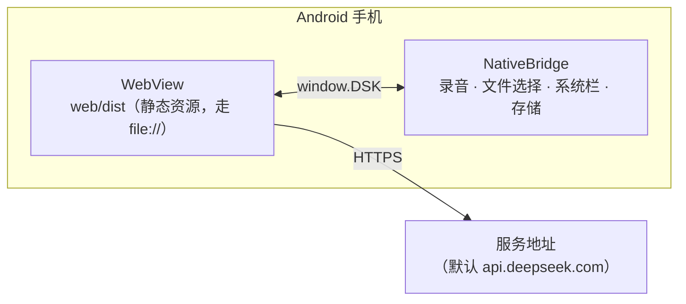

# 架构

一句话：**网页端是一个纯静态的 React 应用，Android 端是一个只负责"给 WebView 补能力"的壳**。没有中间层服务器，所有请求从手机直连你填的服务地址。

## 两层

- **网页端**（`web/`）：React 18 + TypeScript + rspack 2，产物 4.3 MB。所有业务逻辑、协议解析、界面都在这里；它不知道自己在浏览器里还是在 WebView 里。
- **Android 壳**（`android/`）：`MainActivity` 负责 WebView 宿主、文件选择、权限、错误面板；`NativeBridge` 把浏览器给不了的能力（原生录音、系统栏高度、写文件）暴露成 `window.DSK.*`。

能过一遍浏览器就过一遍浏览器——所以网页端的构建产物本身就是可用的产品，Android 只是把它装进一个能录音、能选文件的外壳里。

## 请求

全部走 Anthropic 兼容的 Messages 协议，前缀是 `{服务地址}/anthropic/v1`。

| 调用 | 位置 | 说明 |
| --- | --- | --- |
| `GET /models` | `services/api/client.ts` | 校验 API Key，不产生费用 |
| `POST /anthropic/v1/messages` | `services/api/client.ts` | 主对话，`stream: true` |
| `POST /anthropic/v1/files` | `services/api/client.ts` | 上传图片与文档，换回 `file_id` |
| `DELETE /anthropic/v1/files/{id}` | `services/api/client.ts` | 删掉云端文件 |
| `POST /v1/tools/asr` | `services/speech` | 语音识别 |
| `POST /v1/tools/tts` | `services/speech` | 朗读 |

鉴权用 `x-api-key`（也兼容 `Authorization: Bearer`）。引用上传的文件时要带 `anthropic-beta: files-api-2025-04-14`。

流式响应由 `services/api/sse.ts` 逐帧切开，`parseEvent.ts` 把每一帧读成 `MessageStreamEvent`（`message_start` / `content_block_delta` / `message_delta` / `message_stop` …）。用量就是在这里抠出来的：`message_start` 给输入侧（未命中、缓存读取、缓存写入），末尾的 `message_delta` 只信它的 `output_tokens`——服务端会把末尾的输入侧字段一并带成 0。

## 状态与存储

| 层 | 技术 | 存什么 |
| --- | --- | --- |
| 界面状态 | zustand | 设置、当前会话、会话列表、弹窗 |
| 结构化数据 | IndexedDB（`idb`） | 会话、消息分支、附件元数据 |
| 会话设置 | localStorage | API Key、模型、模式、思考强度、语言、主题、服务地址、技能与 MCP 配置 |
| 附件原件 | IndexedDB blob | 图片原件与导出用副本 |

会话是**树**不是链表：一条消息可以有多个版本（重新生成产生新分支），切换版本只改当前指针，所以"上一个版本 / 下一个版本"是 O(1) 的。

## 原生桥

网页侧只有 `services/native/native.ts` 一个文件碰 `window.DSK`，其余代码不感知原生。暴露的方法：

| 方法 | 用途 |
| --- | --- |
| `insets()` | 系统栏 / 刘海高度，写成 CSS 变量 |
| `info()` | 版本号、平台信息 |
| `storage()` | 本机占用与可用空间 |
| `openExternal(url)` | 用系统浏览器打开外链 |
| `startCloudSpeech(apiKey, origin, language)` / `stopCloudSpeech()` / `cancelCloudSpeech()` | 原生录音并直传 ASR |
| `startSpeech()` / `stopSpeech()` / `cancelSpeech()` / `speechStatus()` | 系统语音识别（老路线，保留） |
| `writeStoreFile(name, content)` / `readStoreFile(name)` / `deleteStoreFile(name)` | 应用私有目录读写 |

反向通道是 `MainActivity.dispatchSpeechEvent(json)`：原生把录音状态、转写结果、错误以 JSON 事件推给网页。

为什么要原生录音：`file://` 页面用 `getUserMedia` 在很多机型上直接 `NotAllowedError`；而系统 `SpeechRecognizer` 在没有 Google 语音服务的机型上 `isRecognitionAvailable()` 就是 false。原生 `AudioRecord` 两个问题都绕开，录音质量也可控（16 kHz 单声道 16-bit PCM，手动拼 44 字节 WAV 头）。

## 老 WebView 兼容

这是这个项目花时间最多的地方，也是几处看起来"多余"的配置的由来：

- JS 目标 `chrome >= 61`：主 bundle 一旦用了新语法，老内核整页 `SyntaxError` + 白屏，且没有可见报错
- `publicPath: 'auto'` + 经典 `defer` 脚本：`file://` 下异步 chunk、字体都要按相对位置加载
- `viewport-fit=cover` + 原生 `insets()`：状态栏/导航栏留白，不然顶栏的"+"会被压住
- 错误面板：`MainActivity` 收集 console error，资产挂载失败时直接在原生层画出错误详情，而不是留一块白屏

## 扩展

- **技能**：`services/skills` 里存技能列表，启用的技能内容在发请求前拼进系统提示词（单条 8000 字、合计 24000 字封顶）。内置三个：办公文档、数据与表格、中文润色。
- **MCP**：只支持流式 HTTP（`mcp-protocol-version: 2024-11-05`）。工具定义跟着请求走，模型发起工具调用后由前端执行、把结果放回对话，形成工具回环；每轮算一步，所以状态条上的"步"会比"轮"多。最多 64 个工具，单条结果 8000 字截断。

## 为什么不用 Gradle

只有两个 Java 文件、一个清单、一组 mipmap。上 Gradle 就要引入 AGP、版本匹配、依赖仓库，而收益只有"增量编译"和"IDE 集成"。用 `aapt2 + javac + d8 + jar + zipalign + apksigner` 六个命令拼出来的构建脚本 80 行，跑一次十秒，还顺手绕开了中文路径与 ANSI 代码页的坑（细节见 [BUILD.md](BUILD.md)）。

代价是：没有资源混淆、没有 ABI 拆分、没有版本管理工具链——对一个 2 MB 的壳来说都不需要。
